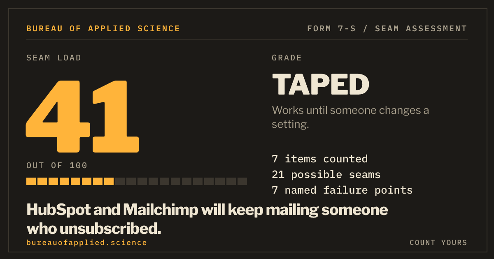
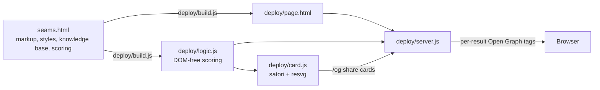

<div align="center">

# SEAMS

**How many seams are holding your software together?**

An instrument from the [Bureau of Applied Science](https://bureauofapplied.science).
Tap the tools you run. Get a seam load from 0 to 100, the failure points that matter, and a card to show your team.

[**Try it**](https://seams.bureauofapplied.science) &nbsp;|&nbsp; [Specification](https://bureauofapplied.science/instruments/seams) &nbsp;|&nbsp; [Request a seam audit](https://bureauofapplied.science/contact)




</div>

## The idea

Software rarely fails inside a tool. It fails in the gap between two of them: the sync that lags, the webhook that drops, the login nobody remembered to remove.

SEAMS counts those gaps. You pick the software you run, then answer one question: when a connection breaks, who finds out first? A customer, whoever happens to notice, one person who watches, or an alert and a runbook. It returns:

- a **seam load** from 0 to 100
- a **grade** from SOUND to CRITICAL
- a list of **named failure points**, each with a check you can do this month
- a **card** and a **link** you can send to someone

There are no accounts. The result is the link.

## What it knows

| | |
|---|---|
| Selectable items | 291, in 34 categories |
| Failure patterns | 85 hand-written category pairs, each with a risk and a check |
| Same-category patterns | 31, for two tools doing the same job, such as two password managers |
| Industry starting points | restaurant, salon, trades, hotel, online store, course creator, consultancy, therapy practice |

The severities are judgment from operating real stacks, not measurements. The page says so, and so does this file.

## How the score works

Each seam between two selected tools has a severity of 1 to 3, taken from the category-pair knowledge base.

- **Same suite.** Two tools from one vendor suite score one step lower, because the vendor builds and maintains that connection. A pair already at severity 1 drops out. Password, AI and automation tools are not discounted, since their risk is access and oversight, not the integration.
- **Who finds out first.** The answer scales the total: a customer 1.5, whoever notices 1.3, one person who watches 1.1, an alert then a runbook 0.7. Glue tools such as automation platforms add 15 percent.
- **Curve.** `score = round(100 * (1 - exp(-w / 34)))`, where `w` is the weighted sum. The first seams matter most, and the score approaches 100 without reaching it.

| Score | Grade | Meaning |
|---|---|---|
| below 15 | SOUND | Nothing here is likely to surprise you. |
| 15 to 34 | STITCHED | Held together, mostly on purpose. |
| 35 to 54 | TAPED | Works until someone changes a setting. |
| 55 to 74 | LOAD-BEARING | Something important is resting on something small. |
| 75 and up | CRITICAL | One vendor update from a bad Tuesday. |

The scoring is deterministic: the same selection always gives the same result. `seams_check2.js` asserts that and prints calibration cases.

## Privacy by construction

- The assessment runs in your browser. The state is encoded in the URL, so a server that serves your link sees it in its request log. The deployed reference setup masks IPs to /24 and /48 and drops cookies and authorization headers.
- No accounts, no cookies, no third-party scripts.
- The contact handoff happens only on a click, and nothing is sent until you press Send.
- A first-party beacon counts named actions only. Its payload is exactly an event name, a grade and a preset id. Never the stack, the link or an identifier. The server allowlists every field, caps the body at 512 bytes and throttles per IP without storing the IP.
- A strict Content-Security-Policy is built at startup from hashes of the inline script and styles.

## Architecture



The whole assessment is one file, `seams.html`. The build splits out a server page with an Open Graph slot and a DOM-free copy of the scoring block. The server uses them to give every result link and every industry link its own preview card.

| Path | What it is |
|---|---|
| `seams.html` | The assessment: markup, styles, knowledge base and scoring logic. The source of truth. |
| `deploy/build.js` | Builds `deploy/page.html` and `deploy/logic.js` from `seams.html`. |
| `deploy/server.js` | Serves the page with per-result Open Graph tags, renders cards at `/og`, takes the beacon at `/b`. |
| `deploy/card.js` | Share card renderer. |
| `deploy/events-summary.js` | Counts events from the beacon log. |
| `deploy/report.sh` | Builds traffic and per-link reports from a Caddy JSON access log. |
| `deploy/ecosystem.config.js`, `deploy/*.conf` | Example PM2 and Caddy configuration. |
| `deploy/fonts` | Self-hosted fonts, with their licenses. |
| `seams_check2.js`, `seams_domtest.js`, `deploy/server-check.js` | The checks. |

## Run it

Developed and run on Node 22.

```
cd deploy
npm install
node build.js
node server.js
```

Open http://127.0.0.1:3010.

| Variable | Default | Purpose |
|---|---|---|
| `PORT` | `3010` | Listen port. |
| `HOST` | `127.0.0.1` | Listen address. |
| `ORIGIN` | `https://seams.bureauofapplied.science` | Public URL used in meta tags and share links. Set it to your own. |
| `EVENTS_FILE` | `deploy/data/events.ndjson` | Where the beacon appends events. |

The server reads `page.html` once at startup, so restart it after a rebuild.

### Links

| Link | Result |
|---|---|
| `/?start=restaurant` | An industry starting stack, already scored, with its own preview card. |
| `/?r=<state>` | A shared result. The state is a compact encoding of the selection. |
| `/og?r=<state>` or `/og?start=<id>` | The share card as a PNG. |

Permalinks never change meaning: the tool registry is append-only, so a link made today still decodes tomorrow.

## Test

```
node seams_check2.js                                 # knowledge base and scoring; "problems" must be []
npm install --no-save jsdom                          # once
node seams_domtest.js                                # DOM behavior; 0 failed
cd deploy && node build.js && node server-check.js   # server; 0 failed
```

## About

SEAMS is an instrument of the Bureau of Applied Science, a consultancy in Colorado Springs, Colorado, run by Jason Sayre. The Bureau publishes instruments, small tools that state their rules and show their reasoning.

If SEAMS scored your stack higher than you would like, that is the work:

- **Request a seam audit:** [bureauofapplied.science/contact](https://bureauofapplied.science/contact)
- **Read the method:** [bureauofapplied.science/instruments/seams](https://bureauofapplied.science/instruments/seams)
- **Email:** j@jas.run
- **GitHub:** [@erronjason](https://github.com/erronjason)

## License

Code: MIT, see [`LICENSE`](LICENSE). Fonts (IBM Plex Mono, Libre Franklin): SIL Open Font License 1.1, see [`deploy/fonts`](deploy/fonts). Product and company names in the knowledge base belong to their owners and are used only to name the tools.
